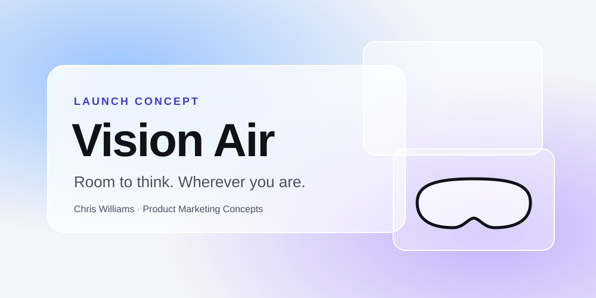
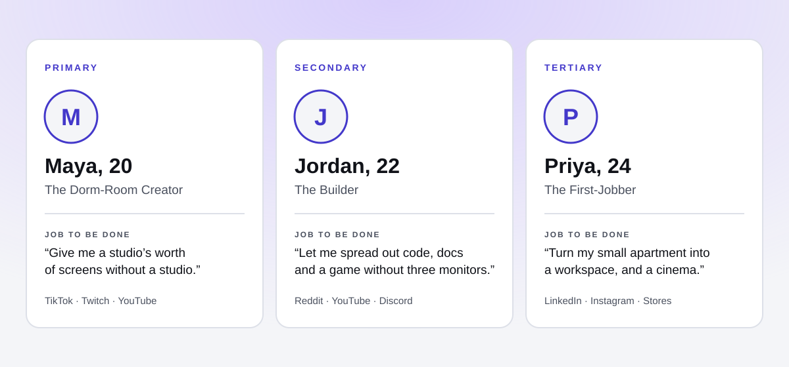
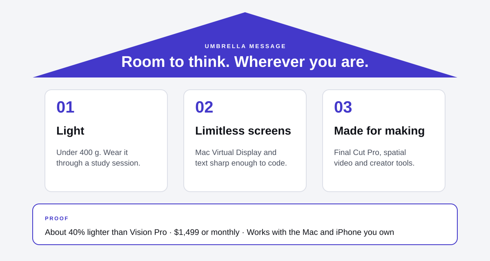
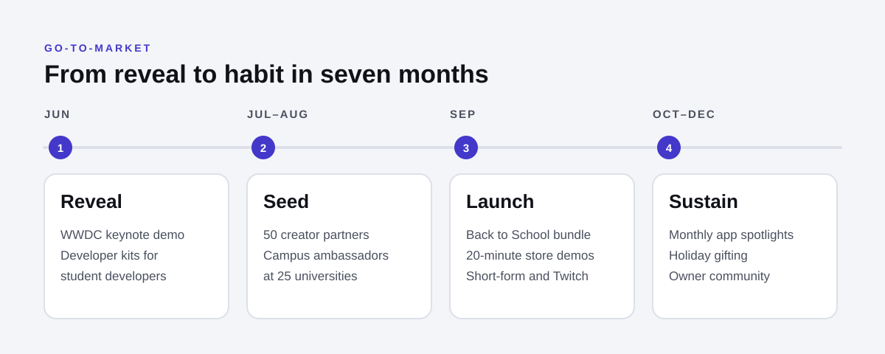

# Apple Vision Air: Launch Concept 🥽

<kbd>
    
</kbd>

## Project Description 🎨

A product launch concept for **Apple Vision Air**, an imagined lighter, lower-priced sibling to Vision Pro, built for students and creators under 25 who need more screen in less space. Vision Pro proved the technology but not the habit: a $3,499 price, comfort complaints and few everyday reasons to wear it kept it niche. This concept repositions spatial computing around a present-tense benefit, **room**, and plans the launch from target personas through positioning, messaging pillars and a phased go-to-market plan with channels, metrics and risks. It is one of Chris Williams's [Product Marketing Concepts](https://allsar2k.github.io/pmm-portfolio/concepts/).

**[View the concept site →](https://allsar2k.github.io/apple-launch-concept/)**

## Screenshots:

    <kbd></kbd>
    <kbd></kbd>
    <kbd></kbd>

## Technologies Used 💻

### Frameworks
- [x] **Jobs to be done** — each persona is defined by the job they hire the product for
- [x] **Positioning statement (Moore)** — for / who / is the / that / unlike
- [x] **Messaging house** — umbrella message, three pillars, proof foundation
- [x] **Phased launch plan** — reveal, seed, launch, sustain
- [x] **Funnel metrics** — awareness to advocacy, with 90-day targets

### APIs & Web Services
- [x] **GitHub Pages** — hosts the one-page concept site
- [x] **GitHub Actions** — checks the design system's colour contrast on every push

### Data Sources
- [x] **IDC estimates via MacRumors and 9to5Mac** — Vision Pro shipments
- [x] **Public pricing** — Vision Pro, Meta Quest 3 and 3S, Ray-Ban Meta
- [x] **Persona research** — composites built from the market research in `docs/01`

## Architecture 🏗️

- **Pattern**: five documents that build on each other: research → personas → positioning → messaging → go-to-market
- **Design system**: [Clear Glass](docs/DESIGN.md), with tokens in `assets/tokens.json` and contrast checked by `scripts/check-contrast.mjs`
- **Graphics**: hand-written SVG with titles and descriptions, so they stay sharp and readable by screen readers
- **Site**: one static HTML page and one stylesheet, no JavaScript and no tracking
- **Target**: any modern browser; WCAG 2.2 AA

## Features 🌟

- 🔎 **[Market research](docs/01-market-research.md)** — why Vision Pro stalled and where the gap is
- 👥 **[Target personas](docs/02-target-personas.md)** — Maya the creator, Jordan the builder, Priya the first-jobber
- 🎯 **[Positioning](docs/03-positioning.md)** — "not a cheaper Vision Pro, the right-sized one"
- 🏛️ **[Messaging pillars](docs/04-messaging-pillars.md)** — Light, Limitless screens, Made for making
- 🚀 **[Go-to-market plan](docs/05-go-to-market.md)** — phases, channels, 90-day metrics and risks
- 🎨 **[Design system](docs/DESIGN.md)** — Clear Glass palette, type and graphics

## Contributing ⚙️

Have a sharper insight, a better source or a counter-argument? Open an issue or fork the repository and send a pull request. Run `node scripts/check-contrast.mjs` before proposing colour changes.

## License 🪪

Site code is MIT licensed. Strategy documents and graphics © Chris Williams; see [LICENSE](LICENSE). This is an independent concept and is not affiliated with or endorsed by Apple Inc.

