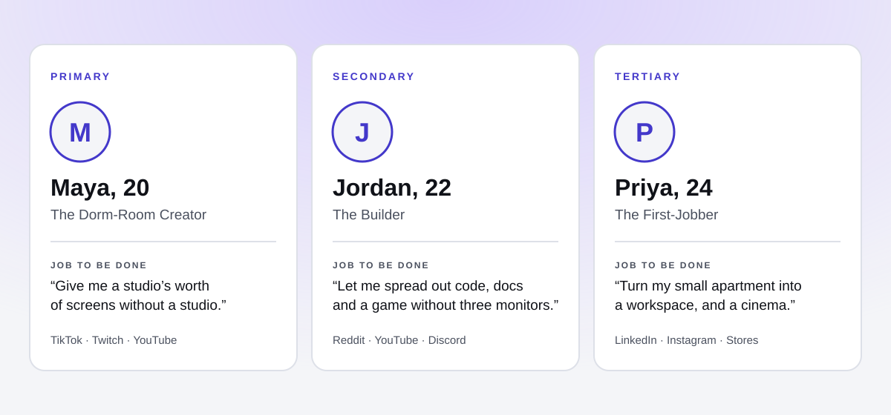

# 02 · Target personas

Three people the launch is built around. Each is a composite drawn from the research in [01 · Market research](01-market-research.md), not a real individual. The primary persona decides trade-offs; the others must not be made worse off by those decisions.

## Primary · Maya, 20, "The Dorm-Room Creator"

- **Who:** Film and media sophomore. Posts short edits, streams twice a week, edits on a MacBook Air at a desk that also holds her textbooks.
- **Job to be done:** "Give me a studio's worth of screens without a studio."
- **Today:** Edits on a 13-inch screen, scrubbing timelines with the trackpad. Borrows the media lab's monitors when she can book them.
- **Barriers:** Price ("that's a semester of rent"), looking odd on camera, motion sickness she has heard about.
- **What would convince her:** Seeing a creator she follows cut a video in it. A monthly price close to her phone plan.
- **Channels:** TikTok, Twitch, YouTube, the campus Apple Store's Today at Apple sessions.

## Secondary · Jordan, 22, "The Builder"

- **Who:** Computer science senior who games and codes. Owns a Windows gaming PC and an iPhone.
- **Job to be done:** "Let me spread out my code, docs and a game without three monitors."
- **Today:** Two secondhand monitors, a laptop, cable mess. Tried a friend's Quest and found text blurry for coding.
- **Barriers:** Mac-only features, "Apple tax", whether it works with his PC.
- **What would convince him:** Sharp text for long coding sessions, an honest list of what works with non-Apple gear.
- **Channels:** Reddit, YouTube reviews, Discord communities, hackathon sponsorships.

## Tertiary · Priya, 24, "The First-Jobber"

- **Who:** Junior product designer, eight months into her first job, living in a one-bedroom.
- **Job to be done:** "Turn my small apartment into a proper workspace, and a cinema after work."
- **Today:** Works from the sofa on a laptop; watches films on a 40-inch TV.
- **Barriers:** Justifying a third Apple device, wearing it for an eight-hour day.
- **What would convince her:** Employer device programs, all-day comfort claims she can try in-store, entertainment that justifies the evenings.
- **Channels:** LinkedIn, Instagram, design newsletters, Apple Store demos.

## What the three have in common

| Need | Maya | Jordan | Priya |
|---|---|---|---|
| More screen in less space | ✔ | ✔ | ✔ |
| Comfortable for long sessions | ✔ | ✔ | ✔ |
| Price that fits a monthly budget | ✔ | ✔ | ✔ |
| Makes things, not just watches | ✔ | ✔ | — |

The shared needs become the messaging pillars in [04 · Messaging pillars](04-messaging-pillars.md).
