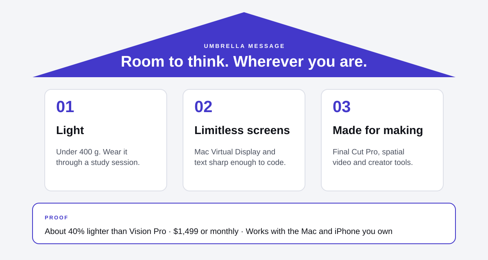

# 04 · Messaging pillars

## Umbrella message

**Room to think. Wherever you are.**

Short enough for a billboard, specific enough to rule things out: it promises space, not spectacle.

## Pillar 1 · Light

*So light you'll forget you're wearing it. Not quite, but close.*

- **Proof:** under 400 g, about 40% lighter than Vision Pro; a balanced strap; a two-hour study session without a break.
- **Speaks to:** everyone, and the comfort objection in particular.
- **Say:** "Wear it through a whole lecture review."
- **Don't say:** "Weightless." It isn't, and the audience will check.

## Pillar 2 · Limitless screens

*Your Mac, your notes and your playlist, side by side, as big as you want.*

- **Proof:** Mac Virtual Display, multiple app windows, sharp text for reading and coding.
- **Speaks to:** Maya's timeline, Jordan's code, Priya's design files.
- **Say:** "A studio's worth of screens on a dorm-room desk."
- **Don't say:** "Replaces your laptop." It works with it.

## Pillar 3 · Made for making

*Edit, stream and capture in a space that was never big enough before.*

- **Proof:** Final Cut Pro, spatial video from iPhone, streaming tools and creator partners at launch.
- **Speaks to:** Maya first; anyone who creates.
- **Say:** "Cut your next video on a screen the size of a wall."
- **Don't say:** "For professionals." That's Vision Pro's line.

## Message by persona

| Persona | Lead pillar | Headline | Call to action |
|---|---|---|---|
| Maya, creator | Made for making | "Your studio fits in a backpack." | Book a 20-minute creator demo |
| Jordan, builder | Limitless screens | "Three monitors. Zero desk space." | Read the text-clarity review roundup |
| Priya, first-jobber | Light | "Work all day. Watch all night. One device." | Check your employer's device program |

## Tone

Confident and plain. Short sentences, real numbers, no "revolutionary". Every claim has to survive a reviewer wearing the product for a week.
