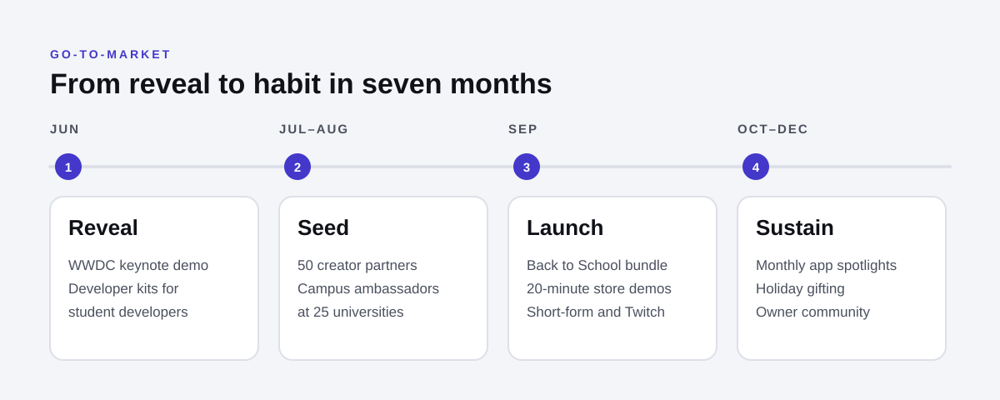

# 05 · Go-to-market plan

## Launch goal

Make Vision Air the first spatial computer that a meaningful share of its owners wear **every week**, not just in the first month.

## Phased plan

### Phase 1 · Reveal (June, at WWDC)

- Announce Vision Air alongside the visionOS release, with developers first: they need the summer to ship apps for it.
- One keynote demo, and only one: a student editing a video across three virtual screens at a small desk.
- Open a developer kit program for student developers through Apple's Swift Student Challenge community.

### Phase 2 · Seed (July–August)

- **Creator partner program:** 50 creators under 25 across editing, streaming, study-with-me and music production get early units. They post honest first-week videos; no scripts.
- **Campus ambassadors:** at 25 universities, students run "Room to Think" study sessions in libraries with demo units.
- **Content:** a "first week" series following Maya-, Jordan- and Priya-like owners, released weekly.

### Phase 3 · Launch (September, Back to School)

- Pre-orders open at the iPhone event; in stores two weeks later.
- **Offer:** Back to School bundle with education pricing, AppleCare and a Final Cut Pro trial.
- **Retail:** a 20-minute demo (shorter than Vision Pro's) with three paths: Create, Study, Watch.
- **Paid media:** short-form video on TikTok, Instagram Reels and YouTube Shorts; Twitch takeovers with creator partners; out-of-home near campuses.

### Phase 4 · Sustain (October–December)

- Monthly visionOS app spotlights on the App Store.
- Holiday gifting push to parents of students: "The gift of room."
- Owner community: shared spatial video challenges, monthly creator live sessions.

## Channel plan

| Channel | Role | Primary persona | Key metric |
|---|---|---|---|
| Creator partners (Twitch, YouTube, TikTok) | Proof from people the audience trusts | Maya | Watch time, demo bookings from links |
| Campus ambassadors | Try it before you buy it | Maya, Jordan | Demo sign-ups per campus |
| Apple Store demos | Fit, comfort and conversion | All | Demo-to-purchase rate |
| Short-form paid social | Awareness at scale | Maya, Priya | Cost per demo booking |
| Reddit / Discord AMAs | Answer the hard questions honestly | Jordan | Sentiment in launch threads |
| Employer device programs | Remove the price objection | Priya | Program enrolments |

## Success metrics

| Stage | Metric | Target in first 90 days |
|---|---|---|
| Awareness | Aided awareness among US 18–24s | 40% |
| Consideration | In-store and campus demos booked | 1 million |
| Conversion | Demo-to-purchase rate | 15% |
| Adoption | Owners using it 3+ days a week at day 30 | 60% |
| Advocacy | Creator partner videos posted organically after the paid period | 70% of partners |

Targets are planning assumptions for the concept, set to be ambitious but checkable, not forecasts.

## Risks and responses

| Risk | Response |
|---|---|
| "Still too expensive" | Monthly pricing leads every ad; employer and education programs; trade-in for iPad and Mac. |
| Motion sickness stories | Demo starts with static windows; publish comfort guidance; avoid fast-moving launch footage. |
| Thin app library | Developer kits in June; a "made for Air" App Store collection at launch. |
| Cannibalising Vision Pro | Keep the line clear: Air for everyday use, Pro for professional immersive work. |
